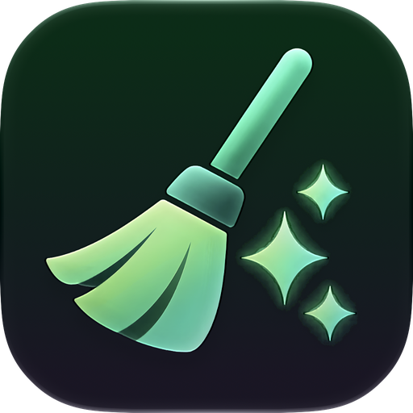
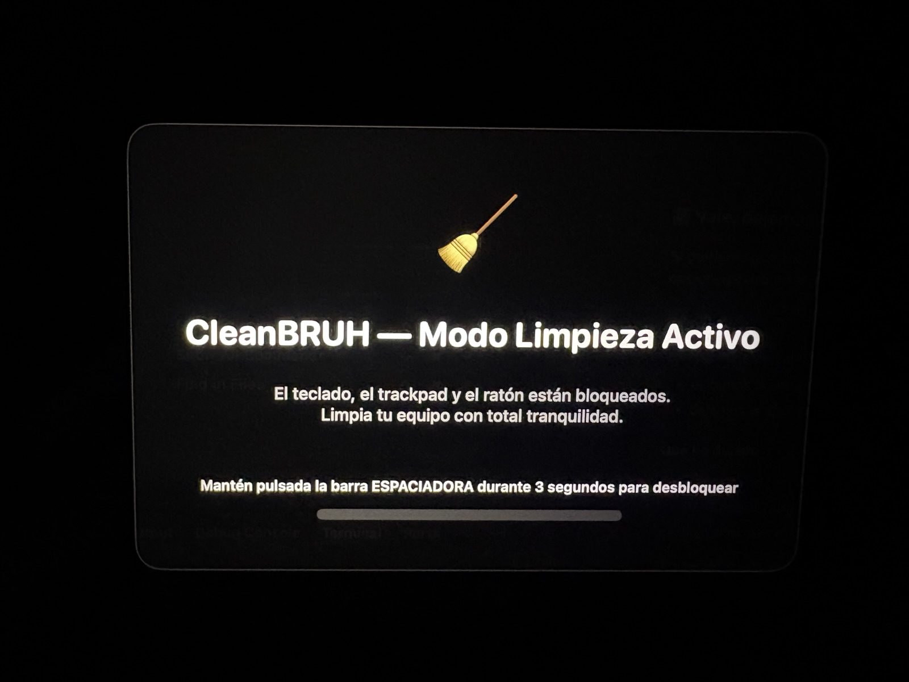

<div align="center">



# CleanBRUH

**Limpia tu Mac sin activar teclas, clics ni gestos por accidente.**

[](https://github.com/pablo96sancho/CleanBRUH/releases/latest/download/CleanBRUH-Installer.dmg)


[🇬🇧 English version](./README.en.md)

</div>

<br />

<p align="center">
  
</p>

CleanBRUH es una app de la barra de menú que bloquea temporalmente el teclado, el ratón
y el trackpad para que puedas limpiar el Mac sin escribir nada, abrir apps ni cambiar el
volumen sin querer.

## Características

- 🧹 Se activa con un clic desde la barra de menú.
- ⌨️ Bloquea teclado, ratón y trackpad al instante, incluidos los atajos y las teclas de función.
- ⏱️ Para desbloquear, mantén pulsada la **barra espaciadora 3 segundos**.
- 💻 Nativa y ligera: hecha en Swift, sin dependencias.

## Instalación

1. [Descarga el instalador](https://github.com/pablo96sancho/CleanBRUH/releases/latest/download/CleanBRUH-Installer.dmg).
2. Ábrelo y arrastra **CleanBRUH.app** a **Aplicaciones**.
3. Ábrela. Aparecerá en la barra de menú.

### Primera apertura

La app no está firmada con una cuenta de Apple Developer, así que la primera vez macOS
la bloquea con un aviso. Para abrirla:

1. Intenta abrir CleanBRUH y cierra el aviso (sin moverla a la Papelera).
2. Ve a **Ajustes del Sistema → Privacidad y seguridad**.
3. En la sección **Seguridad**, pulsa **Abrir igualmente** junto al mensaje sobre CleanBRUH.
4. Confirma con tu contraseña o Touch ID. Solo hace falta la primera vez.

<details>
<summary>Alternativa desde la Terminal</summary>

```bash
xattr -dr com.apple.quarantine /Applications/CleanBRUH.app
```

</details>

### Permisos

CleanBRUH usa un `event tap` de macOS para bloquear la entrada, así que necesita permiso
de **Accesibilidad**: *Ajustes del Sistema → Privacidad y seguridad → Accesibilidad*.

## Desarrollo

Requisitos: macOS 13 o superior, Xcode 15+ (o las Command Line Tools) y Swift 5.9+.

```bash
./build_and_run.sh   # compila y abre la app
./create_dmg.sh      # genera CleanBRUH-Installer.dmg
```

Cada Release de GitHub publica el DMG automáticamente con GitHub Actions.

## Licencia

[MIT](LICENSE) © Pablo Sancho
